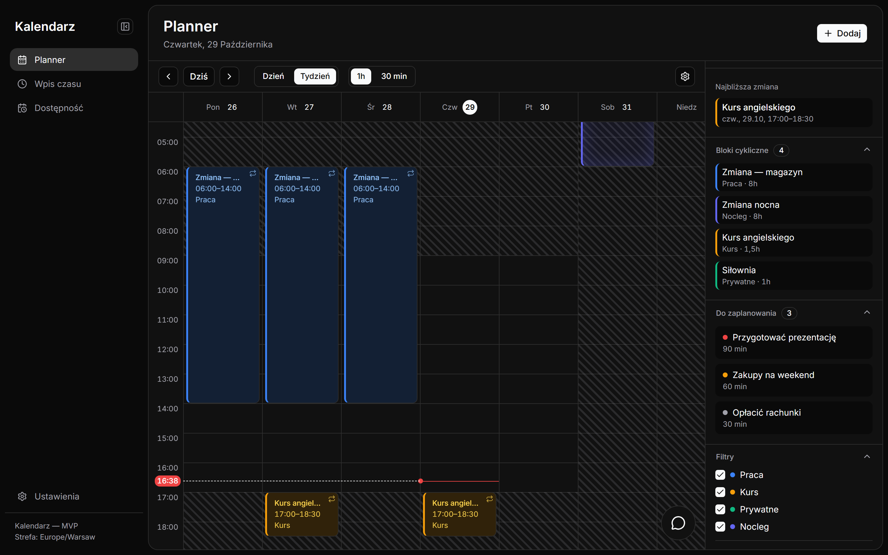

# OpenCal — shift calendar with an AI assistant

A calendar for people with irregular schedules (shifts, night shifts, courses). Recurring blocks show the whole week at a glance, a backlog holds tasks without a date, and an AI chat (Claude or Gemini) finds free time slots and suggests when to do them. A time-tracking module calculates earnings from hours, breaks and extra pay.



**Stack:** Next.js 16 · TypeScript · Tailwind 4 · shadcn/ui · Prisma 7 + PostgreSQL 16 · Vitest + Playwright · Claude API + Gemini API

The interface is in Polish. Sample data in the screenshot is fictional.

---

# OpenCal — inteligentny kalendarz zmianowy

Aplikacja do zarządzania nieregularnym grafikiem pracy (zmiany, kursy) z agentem AI szukającym wolnych okien oraz modułem time tracking + earnings. Ciemny motyw w duchu Cal.com, komponenty shadcn/ui.

## Uruchomienie lokalne

```bash
docker start kalendarz-db   # PostgreSQL 16 (port 5432, baza `kalendarz`)
pnpm install
npx prisma migrate dev      # migracje (connection string w .env)
pnpm dev                    # http://localhost:3000
```

Klucze API (czat AI, Google Calendar) — uzupełnij placeholdery w `.env`. Czat pokazuje tylko modele, dla których klucz jest ustawiony (`ANTHROPIC_API_KEY` → Claude, `GEMINI_API_KEY` → Gemini; wersję Gemini przypniesz w `GEMINI_MODEL`).

## Testy

```bash
pnpm vitest run       # unit (lib/ + API routes, mockowane klienty AI)
pnpm test:e2e         # Playwright (wymaga bazy; reużywa działającego dev servera)
```

Uwaga: testy API routes piszą do deweloperskiej bazy (patrz `vitest.config.ts`); część plików (blocks, backlog, drafts) już sprząta po sobie w `afterEach`, reszta to wciąż dług techniczny — nowy plik testowy piszący do bazy musi kończyć się analogicznym czyszczeniem.

## Struktura

- `app/` — App Router: strony (`/`, `/wpis-czasu`) i API routes (`/api/blocks`, `/api/backlog`, `/api/entries`, `/api/agent`, `/api/analytics`)
- `components/` — `layout/` (nawigacja + czat), `planner/` (siatka, interakcje), `sidebar/`, `blocks/` (modal dodawania), `chat/` (dymek AI), `earnings/`, `ui/` (shadcn)
- `lib/` — czysta logika z testami: rekurencja bloków, gap-finding, earnings, agent (Claude + Gemini)
- `docs/` — specyfikacja, ADR-y, tickety ze statusami ([docs/tickety/README.md](docs/tickety/README.md))
- `DESIGN.md` — tokeny designu (format design.md; `pnpm design:lint`, `pnpm design:export`)

## Stack

Next.js 16 (App Router) · TypeScript · Tailwind 4 · shadcn/ui · Prisma 7 + PostgreSQL 16 · Vitest + Playwright · Claude API + Gemini API
